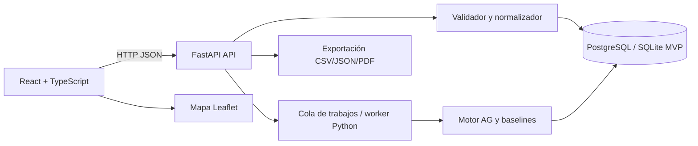

# Plan de implementación — NutriRuta AG

**Proyecto:** Optimizador genético de asignación de canastas alimentarias y rutas de abastecimiento a comedores populares y ollas comunes de Cañete (ODS 2: Hambre Cero).  
**Versión:** 1.0 · **Fecha:** 12/11/2026 · **Estado:** especificación para desarrollo, validación y despliegue.  
**Alcance:** prototipo académico demostrable, no sistema oficial de despacho ni herramienta de decisión autónoma sobre población vulnerable.

> **Regla de consistencia:** los conceptos, las variables, la función fitness y los operadores de este documento son los mismos que figuran en el informe académico. Ninguna métrica de mejora debe publicarse antes de ejecutar las cuatro corridas con datos registrados.

---

## 1. Propósito y resultado esperado

Desarrollar una aplicación web en español en la que una persona pueda **cargar o editar un escenario**, ejecutar un **algoritmo genético (AG)** que decida cuántos lotes alimentarios asignar a cada centro y cómo agrupar/ordenar entregas en vehículos, y **visualizar** las soluciones y su evolución. El objetivo didáctico es mostrar por qué la optimización combinatoria puede apoyar la logística alimentaria de la meta **ODS 2.1**, sin confundir la salida de una simulación con entregas reales.

**Pregunta funcional:** dadas las necesidades de `n` centros, un inventario de `B` lotes, `m` vehículos con capacidad y una matriz de distancias, ¿qué asignación y qué rutas reducen conjuntamente la demanda ponderada no cubierta y la distancia recorrida?

**Usuarios:** estudiante/expositor, evaluador docente y operador de datos de prueba. En el MVP, **no hay registro de beneficiarios individuales** ni acceso público a historiales operativos.

**Demostración de 5 minutos:** cargar escenario demostrativo → ver entradas y restricciones → ejecutar AG con semilla 11 → observar gráfico de mejora del fitness → inspeccionar cromosoma y decodificación → comparar AG contra regla heurística → mostrar 4 corridas precomputadas reales de la aplicación con semillas 11/22/33/44 → exportar evidencias.

### 1.1 Límites explícitos

- La **cifra nacional de inseguridad alimentaria** fundamenta el problema, pero **no es una medición de necesidad por comedor**.
- El padrón público de Cañete acredita centros registrados; **no aporta necesariamente coordenadas, necesidades de lotes, matriz de carreteras, stock ni flota**. Se deben recopilar/validar o simular sin atribuirles origen oficial.
- La fuente municipal enumera campos con **nombres, DNI y sexo**: **no importarlos, mostrarlos, almacenarlos ni utilizarlos para priorización**. Usar únicamente identificador de centro, nombre institucional, distrito, dirección institucional, estado y, si corresponde, número agregado de usuarios. Verificar licencia y actualización.
- La cantidad de usuarios **no equivale automáticamente a demanda**. Las necesidades `d_i` se cargan explícitamente o se derivan mediante una **regla declarada**, p. ej. `ceil(usuarios × raciones_por_usuario / raciones_por_lote)`; etiquetar toda demanda inferida.
- Cualquier **prioridad** `p_i` debe provenir de un criterio institucional documentado y auditable; **no inferir vulnerabilidad de personas, barrios, sexo ni nombres**. Para datos no verificados usar prioridad uniforme `p_i=1` o escenario totalmente sintético.
- Se modelan **lotes homogéneos de alimentos no perecibles**, sin valor nutricional calculado, sin cadena de frío, sin tiempos de servicio y sin tráfico en tiempo real. Las entregas reales exigen controles sanitarios y operativos ajenos al MVP.

## 2. Trazabilidad de fuentes y datos

| Fuente | Qué justifica | Qué NO justifica |
|---|---|---|
| Naciones Unidas, ODS 2, meta 2.1 | Pertinencia de acceso a alimentos inocuos, nutritivos y suficientes | Que mejorar rutas mida una reducción de hambre |
| Programa Mundial de Alimentos, ficha Perú | Contexto nacional de inseguridad alimentaria; indica 51,7 % para 2024 | Demanda de centros específicos de Cañete |
| Defensoría del Pueblo (2025), Informe Defensorial 242 | Problemas de gestión/abastecimiento y necesidad de coordinación | Que una ruta concreta sea deficiente sin medición |
| MIDIS (22/05/2026) | Existencia y relevancia de comedores/ollas comunes en atención alimentaria | Que todas las organizaciones reciban víveres por reparto (hay compras directas) |
| Municipalidad Provincial de Cañete (2026), padrón | Fuente pública potencial de nombres y direcciones institucionales | Coordenadas geográficas verificadas, demanda por período, stock o distancias viales |
| Diapositivas de R. Delgadillo | Base pedagógica de AG, selección, fitness, codificación y operadores | Evidencia de eficacia empírica del prototipo |

**Enlaces oficiales:**

- https://sdgs.un.org/goals/goal2
- https://es.wfp.org/paises/peru
- https://www.defensoria.gob.pe/wp-content/uploads/2025/04/id_crisis_alimentaria-2-1.pdf
- https://www.gob.pe/institucion/midis/noticias/1396310-midis-fortalece-alimentacion-de-mas-de-un-millon-de-personas-usuarias-de-comedores-populares-y-ollas-comunes
- https://www.datosabiertos.gob.pe/dataset/comedores-populares-y-ollas-comunes-de-la-provincia-de-ca%C3%B1ete-mpc
- Diccionario de datos del padrón: https://www.datosabiertos.gob.pe/node/23904/download

### 2.1 Estrategia de carga

1. **Modo DEMO:** generador determinista de 15–20 centros y 3 vehículos, coordenadas y demandas **sintéticas** dentro de un área ilustrativa; no usar nombres reales con coordenadas inventadas (riesgo de aparentar precisión falsa).
2. **Modo PADRÓN:** usuario descarga el recurso oficial desde su página, revisa fecha/licencia y sube una copia local depurada. La aplicación presenta mapeo de columnas y vista de qué campos serán **descartados**, particularmente `DNI`, nombres de personas y `sexo`.
3. En el proceso de homologación, rechazar entidades duplicadas por código, ignorar filas inactivas si el campo existe, estandarizar distrito/dirección, validar latitud/longitud **únicamente cuando estén presentes** o se incorporen mediante validación manual. Registrar origen de cada dato (`oficial`, `declarado`, `sintético`).
4. Requerir que el usuario complete `demanda_lotes`, `prioridad`, `capacidad_vehículos`, `inventario_lotes`, `depósito` y matriz de distancias. No permitir ejecución del AG sobre escenarios incompletos.
5. **Distancias:** (A) matriz vial verificada mediante archivo CSV; (B) motor local de rutas basado en datos abiertos, si está instalado; (C) distancia Haversine **solo simulación**, rotulada “km en línea recta; no aptos para planificación de reparto”. **Nunca sumar km viales con km Haversine en una corrida.**

## 3. Modelo de optimización — contrato matemático

### 3.1 Entradas y unidades

| Símbolo / campo | Tipo / rango | Significado |
|---|---|---|
| `n`, `center_id` | entero positivo, ID único | Centros de atención elegibles |
| `d_i` / `demand_lots` | entero ≥ 0 | Lotes requeridos por centro para un período definido |
| `p_i` / `priority_weight` | entero 1–3, justificado | Importancia relativa **del centro**, no de personas identificadas |
| `B` / `inventory_lots` | entero ≥ 0 | Inventario total homogéneo disponible |
| `m`, `C_v` | entero positivo | Vehículos y capacidad en lotes del vehículo `v` |
| `D[u][v]` | matriz finita ≥ 0 | Distancia centro-centro / depósito-centro en km, **un único método por corrida** |
| `depot_id` | string | Origen y fin común de cada ruta |
| `D_ref` | real > 0 | Distancia de línea base heurística factible; si = 0 aplicar convención documentada |

**Supuestos de implementación:** no se atiende un centro con múltiples viajes en un mismo período; `q_i ≤ min(d_i,max(C_v))`. Cada centro con `q_i > 0` aparece **una vez** en **una** ruta; cada vehículo realiza a lo sumo un recorrido. Las restricciones de este prototipo pueden dejar demanda insatisfecha incluso cuando hay inventario remanente si la capacidad o la estrategia de reparación no permiten empaquetarla; la interfaz debe explicarlo.

### 3.2 Cromosoma y decodificación

```
CROMOSOMA = (π, q)
π = permutación de IDs de los n centros      [C07, C01, C11, ..., C03]
q = vector de enteros de longitud n          [ 12,   0,   8, ...,  16 ]
     q[i] está asociado por ID al centro i, no por posición en π
```

- `π`: genotipo de **orden de visita** (todos los IDs exactamente una vez, incluso si `q_i=0`), para aplicar cruce por orden `OX` y mutación por inversión/intercambio.
- `q`: genotipo de **cantidades entregadas**. Cruce uniforme y mutación de ±1 a ±3 lotes (configurable, sin valores negativos).
- **Reparación de inventario:** limitar cantidades al dominio; mientras `sum(q)>B` o `sum(q)>sum(C_v)`, quitar un lote al centro de menor prioridad con cantidad positiva (desempate por orden fijo de ID o RNG con semilla).
- **Decodificación por capacidad:** organizar entregas mediante *first-fit decreasing* por `q_i`, desempatar por posición en `π`; asignar al primer vehículo con espacio suficiente. Si falla el empaquetado, disminuir un lote en un centro de menor prioridad y reintentar hasta obtener rutas viables. **Registrar cada lote reducido por reparación.**
- Ordenar los centros de cada vehículo con el **suborden de `π`**; agregar depósito al inicio y fin; calcular distancia desde `D`.
- Si `B=0`, `d_i=0` para todos, no existen vehículos o la matriz no es válida, abortar o gestionar caso vacío explícito (sin dividir entre cero); el frontend explica el caso.
- Mejoras posteriores: inserción de menor coste e intercambios entre rutas, siempre preservando cobertura y restricciones; **fuera de MVP** para mantener comparaciones limpias.

### 3.3 Restricciones duras (deben valer para todo resultado)

```
∀i: 0 ≤ q_i ≤ d_i  y  q_i ≤ max_v(C_v)
Σ_i q_i ≤ B
∀v: Σ_{i asignado a v} q_i ≤ C_v
∀i con q_i>0: exactamente una visita y un vehículo
∀v usado: ruta = [depot, ...centros..., depot]
π: es una permutación completa y sin repetidos
```

**Si un centro necesita más de un vehículo**, la solución ofrecida es una entrega parcial; **no** representar satisfacción completa ficticia. Si la demanda total es superior al inventario o capacidad agregada, mostrar bandera “escasez estructural” y cuantificarla.

### 3.4 Función objetivo y fitness

```
U = Σ_i p_i·(d_i-q_i) / max(1, Σ_i p_i·d_i)    demanda ponderada no satisfecha
R = distancia_total_km / D_ref                    costo relativo de transporte
H = (# centros p_i=3 con q_i=0) / max(1, # centros p_i=3)

J = 0.75·U + 0.20·R + 0.05·H       (minimizar)
fitness = 1 / (1 + J)              (maximizar; siempre > 0)
```

Los coeficientes son **parámetros experimentales** ilustrativos, no valores institucionales. `D_ref` se calcula UNA SOLA VEZ por escenario con una línea base factible: atender por prioridad descendente (desempate por ID), asignar hasta capacidad e inventario y ordenar cada ruta por vecino más cercano. Si `D_ref=0` por una solución sin viajes, asignar `D_ref=1 km` **solo como convención de normalización** e informar la excepción. Evitar dividir por cero al no existir prioridades altas. Al comparar semillas o algoritmos, conservar **exactamente la misma matriz y `D_ref`**.

**Métricas auxiliares:** lotes distribuidos, demanda total/ponderada cubierta, demanda pendiente, porcentaje de centros atendidos, número de vehículos usados, km totales, suma de cargas por vehículo, factibilidad, duración de CPU, evolución del mejor fitness/fitness promedio y diversidad de la población. No afirmar “personas alimentadas” sin equivalencia verificable entre lotes y raciones por período.

## 4. Algoritmo genético — contrato operativo

| Componente | Implementación MVP | Parámetro inicial |
|---|---|---|
| Población inicial | 70 % aleatoria, 20 % sesgada por prioridad, 10 % heurística perturbada; reparar y decodificar | 100 individuos |
| Selección | Torneo de 3 individuos; mayor fitness gana; reproducible | `k=3` |
| Cruce de permutación `π` | **Order Crossover (OX)**, respeta IDs sin duplicar | `p_c=0.90` |
| Cruce de cantidades `q` | Uniforme gen por gen, sin mezclar índice con orden de `π` | bajo el mismo evento de cruce |
| Mutación de `π` | Intercambio de dos centros o inversión de subcadena | `p_π=0.15` por individuo |
| Mutación de `q` | Un gen ±1/±2/±3 lotes, saturado a rango | `p_q=0.08` por gen |
| Reemplazo | Generacional con **elitismo** de 2 mejores | `elite=2` |
| Parada | 200 generaciones o 35 generaciones sin mejora ≥ 1e-6 | `G_max=200` |
| Reproducibilidad | `numpy.random.Generator(PCG64(seed))` *o* `random.Random(seed)`, usar **uno** en todo el flujo | semillas 11,22,33,44 |

**Invariantes:** `fitness` se computa **después** de reparar/decodificar; si falla el decodificador no publicar salida inválida. Registrar versión del código, hash del dataset y parámetros. No modificar los parámetros entre las cuatro corridas obligatorias.

**Pseudocódigo:**

```text
validar escenario y calcular matriz de distancias
construir línea base determinista y D_ref
P0 ← población aleatoria + heurística; reparar, decodificar y evaluar
mejor_global ← mejor(P0)
para t = 1 ... 200:
    nueva ← copias exactas de los 2 mejores de Pt-1
    mientras |nueva| < 100:
        padre1, padre2 ← torneo(Pt-1, k=3)
        (π1,π2) ← OX con probabilidad 0.90; en otro caso copias
        (q1,q2) ← cruce uniforme bajo el mismo evento
        mutar π y q según sus probabilidades
        reparar + decodificar + evaluar cada hijo
        añadir hijos hasta completar 100
    Pt ← nueva
    actualizar mejor_global, historial y criterio de estancamiento
validar la mejor solución desde cero (assert de restricciones)
retornar mejor_global, baseline, métricas, historial y metadatos
```

## 5. Arquitectura de software



**Stack recomendado** (preferentemente gratuito y autocontenido):

- **Frontend:** React + TypeScript + Vite, Tailwind CSS opcional, componentes accesibles, Recharts para fitness y métricas, Leaflet para mapas. No depender de una cuenta comercial para ejecutar la demo.
- **Backend:** Python 3.12 o versión soportada, FastAPI, Pydantic, NumPy, pandas y `pytest`. Modelar AG en módulos propios, **sin** esconder la lógica en una biblioteca opaca; NumPy únicamente para utilidades y aleatoriedad. Evitar ficheros con datos personales.
- **Persistencia:** SQLite para desarrollo personal y demo local; PostgreSQL para múltiples usuarios. Esquemas de escenarios, corridas, parámetros, soluciones, historial y provenance. Redis + RQ/Celery **opcional** cuando se necesiten trabajos durables; no asumir que el servidor HTTP puede ejecutar cálculos largos sin aislamiento.
- **Mapa:** Leaflet, geometría de puntos del escenario, rutas como líneas según datos disponibles. Las líneas rectas para Haversine deben lucir visualmente como aproximaciones; **no simular trazados de calles**. Para rutas viales reales, usar archivo de matriz verificada o motor de ruteo local con datos licenciados y revisar uso de teselas OSM.
- **Entrega:** Docker Compose local (frontend, api, worker, db) con `make demo`; opción de despliegue de demostración en hosting que permita procesos persistentes y consumo moderado, sujeto a sus cuotas vigentes.
- **Licencias:** registrar fuentes de datos, atribuciones de OpenStreetMap si se usa, política de teselas y licencia del repositorio.

### 5.1 Estructura sugerida del repositorio

```text
nutriruta-ag/
├─ README.md                    # objetivos, limitaciones, instrucciones, fuentes
├─ docs/
│  ├─ especificacion.md
│  ├─ modelo-matematico.md
│  ├─ politica-de-datos.md
│  └─ evidencia-corridas.md
├─ frontend/
│  └─ src/{pages,components,features,services,types,tests}
├─ backend/
│  ├─ app/api/{routes,schemas,dependencies}
│  ├─ app/domain/{models,validators,metrics}
│  ├─ app/ga/{chromosome,initialization,selection,crossover,mutation,repair,decoder,fitness,evolution}
│  ├─ app/baselines/{priority_greedy,nearest_neighbor}
│  ├─ app/data/{imports,geocoding,matrix}
│  ├─ app/storage/{models,repository}
│  └─ tests/{unit,property,integration,e2e}
├─ fixtures/{synthetic_small,synthetic_medium,invalid}
├─ scripts/{create_demo,benchmark,export_four_runs}
├─ docker-compose.yml
├─ .env.example
└─ .github/workflows/{ci.yml}
```

## 6. Contratos de datos y API

### 6.1 Escenario normalizado (ejemplo **completamente ficticio**)

```json
{
  "scenario_id": "demo-cañete-001",
  "label": "Escenario sintético para evaluación",
  "data_origin": "synthetic",
  "distance_mode": "haversine_demo",
  "depot": {"id":"DEPOT","lat":-13.07,"lon":-76.39},
  "inventory_lots": 135,
  "vehicles": [{"id":"V01","capacity_lots":50},{"id":"V02","capacity_lots":50},{"id":"V03","capacity_lots":50}],
  "centers": [
    {"id":"C01","name":"Centro ficticio 01","lat":-13.08,"lon":-76.38,"demand_lots":14,"priority_weight":3,"source":"synthetic"},
    {"id":"C02","name":"Centro ficticio 02","lat":-13.06,"lon":-76.40,"demand_lots":12,"priority_weight":1,"source":"synthetic"}
  ],
  "demo_generator_note": "El generador amplía este fragmento a 15–20 centros. Coordenadas y cantidades son de prueba; no representan centros reales."
}
```

**Observación:** el JSON de ejemplo muestra solo dos centros para ilustrar el esquema; el fixture completo será autogenerado y versionado. El punto sintético del depósito también es de prueba. En aplicación usar separador de punto decimal en API, coma decimal en formato de interfaz si corresponde.

### 6.2 Endpoints propuestos (MVP)

| Método y ruta | Función | Respuesta / error |
|---|---|---|
| `GET /health` | Estado técnico | `200` JSON |
| `POST /api/v1/scenarios/validate` | Validar archivo y esquema sin guardar | `200` validez/errores; `422` campos incorrectos |
| `POST /api/v1/scenarios` | Crear escenario depurado | `201` ID, hash y provenance |
| `GET /api/v1/scenarios/{id}` | Leer escenario sin PII | `200/404` |
| `POST /api/v1/baselines` | Calcular línea base | `200` métricas y rutas |
| `POST /api/v1/runs` | Iniciar AG con semilla/parámetros | `202` `run_id` si asíncrono |
| `GET /api/v1/runs/{id}` | Estado `queued/running/completed/failed` | progreso, error legible |
| `GET /api/v1/runs/{id}/solution` | Mejor solución validada | rutas, cantidades, métricas |
| `GET /api/v1/runs/{id}/history` | Fitness por generación | vector para gráfico |
| `POST /api/v1/experiments/four-runs` | Orquestar 4 semillas fijas | IDs por corrida, sin mezclar semillas |
| `GET /api/v1/experiments/{id}/export?format=csv` | Exportar tabla 4 corridas | UTF-8 CSV y metadatos |

**Contratos generales:** errores HTTP estructurados (`code`, `message`, `field`, `details`); `run_id` UUID; límite de centros (MVP 5–50), CSV/XLSX hasta 5 MB configurables, tiempos máximos de trabajo, cancelación de ejecución y recursos, CORS limitado, restricciones de payload, archivos temporales borrados tras procesar.

### 6.3 Esquema mínimo de base de datos

`scenario(id, name, origin, version, hash, created_at, distance_mode, depot, inventory_lots, data_license)`  
`center(scenario_id, center_id, name, district, lat, lon, demand_lots, priority_weight, data_origin)`  
`vehicle(scenario_id, vehicle_id, capacity_lots)`  
`distance(scenario_id, from_id, to_id, km, source)`  
`run(id, scenario_id, seed, parameters_json, status, started_at, ended_at, code_version)`  
`generation(run_id, number, best_fitness, mean_fitness, best_J, diversity)`  
`solution(run_id, chromosome_json, decoded_routes_json, metrics_json, validation_json)`.

Nunca crear tablas `DNI/personas/beneficiarios`; los logs tampoco pueden contener dichos campos.

## 7. Interfaz y experiencia de usuario (UI/UX)

### 7.1 Mapa de navegación

1. **Inicio / ODS 2:** problema, explicación de las entradas, insignia visible “Simulación / Datos reales verificados”, CTA “Crear escenario”.
2. **Escenario:** asistente de 4 pasos: centros → depósito y vehículos → inventario/prioridades → matriz de distancias y validación. Permite cargar demo o CSV y editar tabla con filtros.
3. **Configuración AG:** tarjetas con selección, OX, mutación, elitismo, población, generaciones y semilla; preset “Docente” bloquea valores para las cuatro corridas.
4. **Ejecución:** progreso por generaciones, mejor y media del fitness, botón cancelar, estado de factibilidad y errores.
5. **Resultados:** dos pestañas “Asignación” y “Rutas”; mapa, tabla descargable, demanda atendida, pendiente, km e indicadores de prioridad; comparación AG vs baseline; evidencia de evolución.
6. **Cuatro corridas:** tabla 11/22/33/44 y distribución de resultados, export CSV/JSON y captura para el informe.
7. **Glosario académico:** cromosoma, gen, decodificación, fitness, selección, OX, mutación y elitismo; vincular conceptos a la PPT del curso.

### 7.2 Diseño visual

- Sistema de diseño sobrio, tipografía legible (base 16 px), máximo 2 fuentes; colores accesibles de alto contraste; **no utilizar rojo/verde como único diferenciador**.
- Indicadores KPI con **unidad y definición** visibles: “Lotes entregados”, “Demanda pendiente”, “Distancia estimada (línea recta / vía real)”, “Cobertura ponderada”, “Fitness sin unidades”.
- Mapas con leyenda depot/vehículo/centro no servido y ruta por vehículo, contenedores ajustables, acciones de teclado alternativas al mapa.
- Tabla de centros con ordenación, búsqueda, estado de validación, paginación y descripciones textuales para lectores de pantalla.
- Feedback de importación con resumen de filas aceptadas, duplicadas, rechazadas, campos removidos y naturaleza de la fuente.
- Evitar “Óptimo” o “Mejor del mundo”; mostrar “Mejor solución encontrada en esta corrida”.
- Responsive: escritorio 2 columnas (parámetros y mapa) y móvil 1 columna con mapa colapsable; botones mínimo 44 × 44 px, focus visible, etiquetas de formularios, mensajes de error junto al campo.
- Animaciones solo opcionales, con respeto a `prefers-reduced-motion`; la evolución se puede pausar.

### 7.3 Historias de usuario verificables

| ID | Historia | Criterio de aceptación |
|---|---|---|
| HU-01 | Como estudiante, cargo escenario demo | Se generan centros ficticios con semilla de fixture fija y origen marcado |
| HU-02 | Como operador, importo un padrón | DNI/nombres de personas/sexo se eliminan antes de persistir y reportan como descartados |
| HU-03 | Como docente, ajusto restricciones | Rechaza capacidad negativa, coordenadas inválidas y matriz incompleta |
| HU-04 | Como estudiante, corro AG | Ve fitness por generación y rutas sin duplicados |
| HU-05 | Como evaluador, comparo alternativas | Misma instancia, mismas unidades y misma `D_ref` para ambos métodos |
| HU-06 | Como expositor, obtengo evidencia | Exporta semillas, parámetros, métricas, versión y fecha |
| HU-07 | Como usuario móvil, interpreto el resultado | KPIs y tabla legibles sin interacción obligatoria con mapa |

## 8. Construcción por fases y definición de terminado

**Estimación orientativa para 2 personas: 5 semanas; replanificar según disponibilidad.** El backend con motor AG y datos va antes de los gráficos, para evitar una demo vistosa pero inválida.

| Semana / fase | Trabajo de programación | Entregable y prueba para cierre | Responsable sugerido |
|---|---|---|---|
| 1 — modelo y datos | Acordar decisiones, unidad de lote, fuente y privacidad; fixtures de 6 y 20 centros; validador de CSV/JSON y matriz | Documento de invariantes + fixture reproducible + tests de validación | Ambos (A modelo; B datos) |
| 2 — motor AG | Cromosoma, reparación, decodificación, fitness, baseline, OX, mutaciones, torneo y elitismo | Tests unitarios y por propiedades; API devuelve solución factible | A (motor) |
| 3 — API + UI básica | Escenarios, estados de corrida, tabla de resultados, controles, persistence | Flujo completo: cargar → validar → ejecutar → ver resultado | A API; B UI |
| 4 — observabilidad y resultados | Progreso, gráfico fitness, mapa, comparativa, exportación y 4 semillas | Capturas y CSV con hashes, reproducibilidad; accesibilidad básica | B UI; A validación |
| 5 — robustez + entrega | Tests E2E, seguridad de importación, Docker Compose, documentación y ensayo | `make demo`, CI en verde, 4 corridas reales, informe completado por compañero | Ambos |

**Prioridad P0:** dominio correcto, validación de factibilidad, cuatro corridas reales, exportación.  
**Prioridad P1:** visualizador de mapa y diagrama cromosoma→solución.  
**Prioridad P2:** comparación interactiva de operadores o análisis de sensibilidad de pesos (hacer después de cumplir las cuatro corridas).

### 8.1 Definición de terminado para cada PR

- Tipado, estilo (`ruff` Python, `eslint`/Prettier TypeScript), revisión cruzada y CI exitosos.
- Tests de cambios, validaciones y errores accesibles, sin fuga de PII.
- Documentación de cualquier modificación a unidades, fórmula o parámetros.
- Resultado de prueba reproducible con semilla, hash de escenario y versión de código.
- Ningún bug conocido que viole demanda, inventario, capacidad o unicidad de visitas.

## 9. Plan de validación científica y técnica

### 9.1 Tests unitarios obligatorios

1. `OX`: resultado es permutación del mismo conjunto de IDs (sin faltantes ni duplicados).
2. Cruce uniforme `q`: cada gen del hijo procede del gen correspondiente de un padre, **no** de posición permutada.
3. Mutación: mantiene dominios, no crea IDs nuevos ni valores negativos.
4. Reparación: termina, respeta `B` y `C_v` y documenta modificaciones.
5. Decodificación: cada centro con `q_i>0` se visita exactamente una vez; rutas inician/terminan en depósito.
6. Fitness: recomputar a mano para un fixture de 3 centros y 2 vehículos; **mayor `J` implica menor fitness**.
7. Ruido/semilla: dos ejecuciones con igual escenario/seed/parámetros/version producen el mismo historial y cromosoma (sin paralelismo no determinista).
8. Datos: CSV corrupto, duplicados, `NaN/Inf`, distancias negativas, matriz no cuadrada, coordenadas fuera de rango, `B=0`, `n=0`, capacidad 0, distancias simétricas/asimétricas según modalidad.
9. Seguridad: columnas `DNI`, `sexo`, `nombres_apellidos` **nunca** quedan en base de datos ni exports.

### 9.2 Tests de propiedades y comparación exacta

- Para instancias pequeñas (`n=5–7`, `B` bajo) enumerar todas las asignaciones `q` y órdenes si son computables, o resolver por fuerza bruta con condiciones claras; comparar `J_AG ≥ J_óptimo` (minimización), nunca lo contrario. Al ser un AG no debe exigirse óptimo en todos los ensayos.
- Evaluar la **factibilidad en 100 % de soluciones publicadas**. Cero violaciones tolerables.
- Calcular línea base determinista y comparar `J`, `U`, `R`, `H` y tiempo, no solo fitness aislado.
- Repetir con 4 semillas 11/22/33/44; informar media y desviación estándar como resumen adicional, **sin reemplazar las cuatro filas individuales**.
- **No manipular pesos o parámetros entre semillas**, porque entonces no serían cuatro corridas comparables.
- Si el AG resulta peor que la línea base en una ejecución, reportarlo; documentar posibles causas de ajuste/heurística/estancamiento.

### 9.3 Hoja de evidencia para sección 8 del informe

| Corrida | Seed | `J` | Fitness | Lotes entregados / demandados | Cobertura ponderada | Distancia km + modalidad | Vehículos | Tiempo s | Factible |
|---|---:|---:|---:|---|---:|---|---:|---:|---|
| 1 | 11 | pendiente | pendiente | pendiente | pendiente | pendiente | pendiente | pendiente | pendiente |
| 2 | 22 | pendiente | pendiente | pendiente | pendiente | pendiente | pendiente | pendiente | pendiente |
| 3 | 33 | pendiente | pendiente | pendiente | pendiente | pendiente | pendiente | pendiente | pendiente |
| 4 | 44 | pendiente | pendiente | pendiente | pendiente | pendiente | pendiente | pendiente | pendiente |

**Adjuntar**: parámetros y versión, tabla de centros, flota, stock, matriz y origen; gráficos de 4 evoluciones; mapa de la mejor corrida, línea base, tabla detallada de asignaciones, evidencia de validación del decodificador, reflexión crítica sobre trade-offs. **No inventar números** para completar el capítulo.

## 10. Despliegue, seguridad y operación

### 10.1 Ruta de despliegue

1. Desarrollar en Git con ramas `main`, `develop` opcional y `feature/*`; revisión antes de fusionar.
2. Archivo `.env.example` sin secretos; configuración por entorno. Variables mínimas `APP_ENV`, `DB_URL`, `MAX_CENTERS`, `MAX_GENERATIONS`, `MAX_UPLOAD_MB`, `CORS_ORIGINS`.
3. Docker Compose local: frontend, API, worker y BD; volúmenes persistentes; healthchecks y límites de CPU/memoria razonables.
4. GitHub Actions: lint, typing, unit, propiedad, integración, build frontend y escaneo de dependencias.
5. Generar fixture demo estático y cuatro resultados reproducibles con comando CLI versionado; registrar `git commit`.
6. Desplegar demo en servidor educativo o máquina local; por defecto **solo datos ficticios**. Si se publica, autenticación para importación y corrida, límites de tasa y caducidad de archivos. No prometer hosting gratuito permanente sin verificar condiciones.
7. Validar tras despliegue la ruta /health, upload demo, ejecución y exportación; disponer de instrucción para rollback.

### 10.2 Riesgos y mitigaciones

| Riesgo | Consecuencia | Mitigación |
|---|---|---|
| Dato de centro desactualizado | Error de cobertura y mapa | Fecha de fuente, revisión humana, estado del centro |
| PII en padrón | Exposición de datos personales | Lista permitida de columnas, sin logs crudos, prueba automatizada |
| Matriz en línea recta asumida vial | Distancias irrealistas | Etiquetas explícitas y matriz vial verificada para afirmaciones operativas |
| Sesgo de prioridades | Centros desfavorecidos | Pesos visibles, criterio justificado, posibilidad de `p_i=1`, análisis de sensibilidad |
| Sobreajuste por cuatro semillas | Conclusiones exageradas | Misma configuración, baselines, limitaciones en informe |
| Convergencia prematura | Poca exploración | Torneo moderado, elitismo bajo, mutación, diversidad por generación |
| Reparación que elimina entregas | Demanda atendida artificialmente baja | Log de reparaciones y cotejo con baseline factible |
| Tareas de cálculo bloquean API | Caída del frontend | Worker, límite de tiempo, estados y cancelación |
| Servicio de mapas externo falla | Demo sin mapa | Vista de tabla siempre operativa; matriz/fixture local |
| Complejidad desbordada | Proyecto no termina | Alcance MVP estricto, funciones P2 pospuestas |

## 11. Criterios de aceptación globales

- [ ] El proyecto corre localmente con instrucciones reproducibles y sin servicios de pago obligatorios.
- [ ] El modo demo trabaja únicamente con centros sintéticos identificados como tales.
- [ ] El importador usa **solo** campos institucionales permitidos y excluye DNI/nombres de personas/sexo.
- [ ] No se ejecuta una corrida sin inventario, demandas, flota, depósito y matriz validados.
- [ ] Todas las soluciones que muestra la aplicación cumplen restricciones de inventario, capacidades y visitas.
- [ ] El AG incluye codificación, decodificación, fitness, selección, OX, mutación, población y elitismo explicables.
- [ ] La visualización muestra asignaciones, rutas, fitness por generación y estado de factibilidad.
- [ ] Existe una heurística baseline comparable en el **mismo escenario**.
- [ ] Se ejecutan y exportan **exactamente cuatro corridas** (11,22,33,44), conservando configuración y escenario.
- [ ] Los resultados y cifras del informe provienen del programa, no de supuestos.
- [ ] La documentación vincula el problema con ODS 2.1 y declara sus límites de impacto real.

## 12. Entrega de proyecto

**Repositorio:** código fuente (frontend, API, motor AG), tests, fixtures, scripts de cuatro corridas, `README.md`, esquema de datos, `docker-compose.yml`, licencia y atribución de datos.  
**Demostración:** URL accesible o `make demo`; video corto como respaldo si la red falla; ficha de prueba y cuatro CSV/JSON.  
**Informe:** completar después la sección 7 (arquitectura, implementación, clases/módulos, flujo, capturas) y sección 8 (corridas, comparación y análisis), con datos calculados por la app.  
**Declaración:** “Herramienta académica de simulación orientada a apoyar el diseño de entregas; los resultados no equivalen a efectos medidos sobre inseguridad alimentaria”.

---

**Referencias base (para documentación y atribuciones):** Naciones Unidas (ODS 2), PMA (Perú), Defensoría del Pueblo (2025), MIDIS (2026), Municipalidad Provincial de Cañete (2026) y material de clase de R. Delgadillo. URLs oficiales en §2; informe Word contiene las referencias en estilo APA 7.
