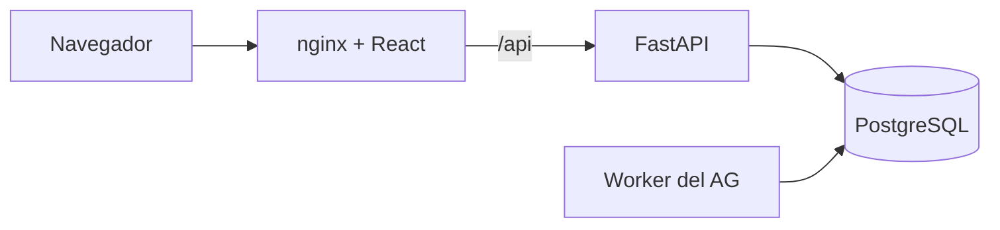

<div align="center">


# NutriRuta AG

**Un algoritmo genético que decide cuántos lotes de alimentos recibe cada comedor y en qué orden los visita cada vehículo.**

[](docs/despliegue.md)
[](backend)
[](frontend)
[](docs/base-de-datos.md)
[](LICENSE)

[Inicio rápido](#inicio-rápido) · [Demostración](#demostración) · [Resultados](#resultados) · [Cómo funciona](#cómo-funciona) · [Documentación](#documentación)


</div>

NutriRuta AG es un simulador académico vinculado al **ODS 2 (Hambre cero), meta 2.1**. Toma el inventario de un depósito, la demanda de los comedores populares y ollas comunes de Cañete y la flota disponible, y propone un reparto de lotes y una ruta por vehículo. Compara siempre el resultado con una línea base simple para mostrar qué gana y qué cede el algoritmo.

> [!NOTE]
> Los datos de la demo son sintéticos y las distancias son en línea recta. El programa sirve para estudiar el comportamiento del modelo; no es un sistema oficial de despacho ni mide efectos sobre la inseguridad alimentaria.

## Qué ofrece

- **Reparto y rutas en una sola decisión:** cada solución es un cromosoma `(π, q)` con el orden de visita y los lotes de cada centro, siempre factible en inventario, capacidad y visitas únicas.
- **Explicación en lenguaje claro:** cada resultado dice a quién se atendió primero, qué ganó y qué cedió frente a la línea base y por qué algunos centros no recibieron todo.
- **Gráficos que enseñan el método:** recorrido paso a paso de cada vehículo, decodificación del cromosoma y ejemplos de torneo, cruce, mutación y elitismo.
- **Escenarios fáciles de cargar:** demo lista, archivo CSV, Excel o JSON, o llenado a mano con un asistente que indica qué falta.
- **Privacidad por diseño:** las columnas con datos personales de un padrón (DNI, nombres, sexo, teléfono) se descartan al importar.
- **Resultados reproducibles:** misma semilla, mismo escenario y mismos parámetros dan siempre la misma corrida.

## Inicio rápido

Necesitas **Docker Desktop** (o Docker Engine con Compose v2). Para exportar la evidencia desde la terminal, además, Python 3.10 o superior.

```bash
git clone https://github.com/iT0XHL/SISTEMA-AG-ODS2.git
cd SISTEMA-AG-ODS2
docker compose up -d --build --wait
```

| Servicio | Dirección |
|---|---|
| Aplicación web | http://localhost:8090 |
| API (documentación interactiva) | http://localhost:8010/docs |
| Estado técnico | http://localhost:8090/health |

> [!TIP]
> Los puertos se cambian con `FRONTEND_PORT` y `API_PORT` en un archivo `.env` (copia `.env.example`). Para ejecutar todo de una vez, `make demo` o, en Windows, `powershell -ExecutionPolicy Bypass -File scripts\demo.ps1`.

## Demostración

1. **Inicio:** pulsa «Usar el escenario demo» (18 centros ficticios, 3 vehículos de 50 lotes, inventario de 135 lotes).
2. **Configuración AG:** elige una semilla; el preset estándar ya trae los valores del informe.
3. **Ejecución:** mira cómo mejora el fitness generación a generación.
4. **Resultados:** lee la explicación, revisa la asignación y recorre las rutas.
5. **Cuatro corridas:** lanza las semillas 11, 22, 33 y 44 y exporta la evidencia en CSV o JSON.

Para probar la carga de datos, descarga desde **Escenario → Nuevo escenario** los archivos de ejemplo: [`centros_ejemplo.csv`](frontend/public/ejemplos/centros_ejemplo.csv) (solo los 18 centros) y [`escenario_ejemplo.json`](frontend/public/ejemplos/escenario_ejemplo.json) (escenario completo, idéntico al demo).

## Resultados

Cifras reales del escenario demo (versión 1.0.0). La [guía de replicación](docs/replicacion-cuatro-corridas.md) explica cómo obtenerlas paso a paso.

| Semilla | J | Lotes entregados | Cobertura ponderada | Distancia (km) |
|---:|---:|---|---:|---:|
| 11 | 0,26278 | 135 / 181 | 85,76 % | 62,61 |
| 22 | 0,26275 | 130 / 181 | 84,24 % | 58,04 |
| 33 | 0,26344 | 135 / 181 | 85,76 % | 62,87 |
| 44 | 0,26603 | 135 / 181 | 85,45 % | 63,00 |
| Línea base | 0,30455 | 135 / 181 | 86,06 % | 80,29 |

`J` es el puntaje total del reparto (menor es mejor). El algoritmo recorre cerca de 23 % menos distancia que la línea base a cambio de cubrir algo menos la demanda ponderada: no mejoran todos los indicadores a la vez.

## Cómo funciona



- **Frontend** (`frontend/`): React, TypeScript y Vite; mapas con Leaflet y gráficos con Recharts.
- **API** (`backend/app/api`): valida escenarios, encola corridas, expone resultados y exportaciones.
- **Worker** (`backend/app/worker.py`): toma las corridas en cola y ejecuta el algoritmo, por lo que se puede seguir el avance o cancelar mientras calcula.
- **Algoritmo** (`backend/app/ga`): población inicial mixta, torneo de 3, cruce OX y uniforme, mutación por intercambio, inversión y ±1…±3 lotes, elitismo de 2, reparación y decodificación en rutas. Minimiza `J = 0,75·U + 0,20·R + 0,05·H`.

## Estructura

```text
backend/    API, algoritmo genético, línea base, importación de datos y pruebas
frontend/   Interfaz web, archivos de ejemplo (public/ejemplos) y prueba en navegador (e2e)
fixtures/   Escenarios sintéticos y casos inválidos de prueba
scripts/    Exportación de las cuatro corridas, benchmark y demo para Windows
docs/       Documentación, evidencia de las corridas y capturas
```

## Pruebas

```bash
docker compose --profile test build tests
docker compose --profile test run --rm tests pytest         # 158 pruebas del backend
cd frontend && npm ci && npm run typecheck && npm run lint && npm test
cd frontend && npm run test:ui                               # recorrido completo en navegador
```

## Documentación

| Documento | Contenido |
|---|---|
| [Guía de replicación](docs/replicacion-cuatro-corridas.md) ([Word](docs/GUIA_REPLICACION_CUATRO_CORRIDAS.docx)) | Cómo replicar las cuatro corridas y comprobar las cifras |
| [Guía de uso](docs/guia-de-uso.md) | La aplicación pantalla por pantalla |
| [Modelo matemático](docs/modelo-matematico.md) | Cromosoma, restricciones, fitness y operadores |
| [Evidencia de las corridas](docs/evidencia-corridas.md) | Resultados completos y análisis |
| [API](docs/api.md) · [Base de datos](docs/base-de-datos.md) | Contratos y esquema |
| [Despliegue](docs/despliegue.md) · [Pruebas](docs/pruebas.md) | Operación y estrategia de validación |
| [Política de datos](docs/politica-de-datos.md) | Privacidad, fuentes y licencias |

## Límites

> [!WARNING]
> - La unidad de optimización es el **lote**, no la persona.
> - El padrón público de Cañete identifica centros, pero no aporta coordenadas verificadas, demandas, stock ni distancias viales.
> - La prioridad de cada centro exige un criterio institucional documentado; sin él, usa prioridad uniforme.
> - Un centro recibe como máximo una entrega por período: si su demanda supera al mayor vehículo, la entrega es parcial.
