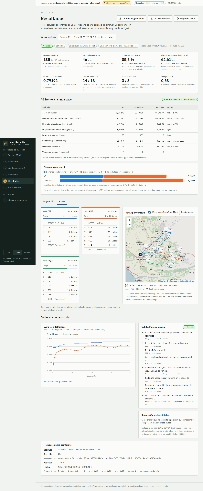

# NutriRuta AG

Optimizador genético de **asignación de lotes alimentarios y rutas de abastecimiento** a comedores populares y ollas comunes de Cañete, vinculado al **ODS 2 (Hambre cero), meta 2.1**.

> **Declaración.** Herramienta académica de simulación orientada a apoyar el diseño de entregas; los resultados no equivalen a efectos medidos sobre inseguridad alimentaria. No es un sistema oficial de despacho ni una herramienta de decisión autónoma sobre población vulnerable.



## Qué hace

Dadas las necesidades de `n` centros, un inventario de `B` lotes, `m` vehículos con capacidad y una matriz de distancias, un **algoritmo genético (AG)** decide cuántos lotes asignar a cada centro y cómo agrupar y ordenar las entregas en vehículos, buscando reducir a la vez la demanda ponderada no cubierta y la distancia recorrida.

- Cromosoma híbrido `C = (π, q)`: permutación de centros + cantidades enteras.
- Reparación y decodificación que garantizan inventario, capacidades y visitas únicas.
- `J = 0,75·U + 0,20·R + 0,05·H` (minimizar) y `fitness = 1 / (1 + J)` (maximizar).
- Torneo de 3, cruce OX + uniforme, mutación por intercambio/inversión y ±1…±3 lotes, elitismo de 2.
- Línea base heurística comparable sobre la misma instancia y la misma `D_ref`.
- Cuatro corridas oficiales con semillas **11, 22, 33 y 44**, exportables a CSV/JSON.

## Inicio rápido

Requisitos: **Docker Desktop** (o Docker Engine + Compose v2). Para exportar la evidencia desde la terminal, además, Python ≥ 3.10 (solo biblioteca estándar).

```bash
docker compose up -d --build        # frontend + API + worker + PostgreSQL
# abra http://localhost:8090
```

Demostración completa (levanta todo y ejecuta las cuatro corridas):

```bash
make demo                                                    # Linux / macOS / Git Bash con make
powershell -ExecutionPolicy Bypass -File scripts\demo.ps1    # Windows
```

| Servicio | URL | Notas |
|---|---|---|
| Aplicación web | http://localhost:8090 | nginx sirve la interfaz y reenvía `/api` |
| API (documentación interactiva) | http://localhost:8010/docs | FastAPI / OpenAPI |
| Estado técnico | http://localhost:8090/health | incluye el estado de la base de datos |

Los puertos se cambian con `FRONTEND_PORT` y `API_PORT` (copie `.env.example` a `.env`).

## Demostración en 5 minutos

1. **Inicio** → «Usar el escenario demo» (18 centros ficticios, 3 vehículos de 50 lotes, inventario 135).
2. **Escenario** → revisar entradas, restricciones y la insignia «Simulación».
3. **Configuración AG** → preset «Docente», semilla 11 → «Ejecutar AG».
4. **Ejecución** → mejora del fitness por generación; se puede reproducir y pausar.
5. **Resultados** → cromosoma y decodificación, rutas en mapa, comparación con la línea base.
6. **Cuatro corridas** → tabla 11/22/33/44, distribución de J, exportar CSV/JSON.

Guía detallada con capturas: [docs/guia-de-uso.md](docs/guia-de-uso.md).

## Resultados medidos (escenario demo)

Cifras producidas por la aplicación el 13/11/2026 (versión 1.0.0, escenario `demo-cañete-001`). Detalle, archivos y cómo reproducirlas en [docs/evidencia-corridas.md](docs/evidencia-corridas.md).

| Corrida | Semilla | J | Fitness | Lotes entregados / demandados | Cobertura ponderada | Distancia (km, línea recta) | Factible |
|---|---:|---:|---:|---|---:|---:|---|
| 1 | 11 | 0,26278 | 0,79191 | 135 / 181 | 85,76 % | 62,61 | sí |
| 2 | 22 | 0,26275 | 0,79192 | 130 / 181 | 84,24 % | 58,04 | sí |
| 3 | 33 | 0,26344 | 0,79149 | 135 / 181 | 85,76 % | 62,87 | sí |
| 4 | 44 | 0,26603 | 0,78987 | 135 / 181 | 85,45 % | 63,00 | sí |
| Línea base | — | 0,30455 | 0,76655 | 135 / 181 | 86,06 % | 80,29 | sí |

Las distancias son en línea recta (Haversine): sirven para simular, no para planificar repartos reales.

## Estructura del repositorio

```text
├─ README.md
├─ docker-compose.yml · .env.example · Makefile · LICENSE
├─ docs/                      documentación (ver índice abajo), evidencia y capturas
├─ backend/
│  ├─ app/api/                rutas, esquemas de entrada, errores, dependencias
│  ├─ app/domain/             modelo del problema, validadores, métricas y validación
│  ├─ app/ga/                 cromosoma, inicialización, selección, cruce, mutación,
│  │                          reparación, decodificador, fitness y evolución
│  ├─ app/baselines/          línea base (prioridad + vecino más cercano)
│  ├─ app/data/               demo sintética, importación de padrón, matriz, coordenadas
│  ├─ app/storage/            modelos SQLAlchemy y repositorio
│  ├─ app/services/           ejecución de corridas, experimentos y exportaciones
│  ├─ app/worker.py           proceso que ejecuta las corridas en cola
│  └─ tests/                  unit · property · integration · e2e
├─ frontend/
│  ├─ src/pages/              Inicio, Escenario, Configuración, Ejecución, Resultados,
│  │                          Cuatro corridas, Glosario
│  ├─ src/components/         gráficos, mapa, cromosoma, hojas de ruta, UI base
│  ├─ src/features/           estado global, borrador de escenario, seguimiento de corridas
│  ├─ src/services/ · types/  cliente de la API y contratos
│  ├─ src/tests/ · e2e/       pruebas unitarias y prueba funcional en navegador
│  └─ Dockerfile · nginx.conf
├─ fixtures/                  synthetic_small (6), synthetic_medium (20), demo (18), invalid
├─ scripts/                   create_demo.py, export_four_runs.py, benchmark.py, demo.ps1
└─ .github/workflows/ci.yml   lint, pruebas, build, escaneo de dependencias y e2e
```

## Documentación

| Documento | Contenido |
|---|---|
| [docs/guia-de-uso.md](docs/guia-de-uso.md) | Cómo se usa la aplicación, pantalla por pantalla |
| [docs/especificacion.md](docs/especificacion.md) | Qué contiene el sistema: arquitectura, módulos, historias de usuario, criterios de aceptación |
| [docs/modelo-matematico.md](docs/modelo-matematico.md) | Cromosoma, decodificación, restricciones, fitness, operadores y parámetros |
| [docs/api.md](docs/api.md) | Endpoints, contratos y ejemplos |
| [docs/base-de-datos.md](docs/base-de-datos.md) | Esquema relacional y diagrama |
| [docs/politica-de-datos.md](docs/politica-de-datos.md) | Privacidad, fuentes, licencias y límites de interpretación |
| [docs/pruebas.md](docs/pruebas.md) | Estrategia de validación y cómo ejecutar las pruebas |
| [docs/despliegue.md](docs/despliegue.md) | Docker, variables de entorno, operación y solución de problemas |
| [docs/evidencia-corridas.md](docs/evidencia-corridas.md) | Las cuatro corridas reales, línea base y análisis |

## Pruebas

```bash
docker compose --profile test build tests
docker compose --profile test run --rm tests pytest        # 158 pruebas del backend (incluye e2e)
cd frontend && npm ci && npm run typecheck && npm run lint && npm test
cd frontend && npm run test:ui                              # recorrido funcional en navegador
```

## Límites explícitos

- La unidad de optimización es el **lote**, no la persona: el programa no mide hambre, estado nutricional ni personas alimentadas.
- El padrón público de Cañete identifica centros; **no aporta** coordenadas verificadas, demandas, distancias viales, stock ni flota.
- **No se importan, muestran ni almacenan** DNI, nombres de personas ni sexo.
- La prioridad `pᵢ` es del centro y exige un criterio institucional documentado; sin él, use `pᵢ = 1`.
- Lotes homogéneos no perecibles: sin valor nutricional, cadena de frío, tiempos de servicio ni tráfico.
- Un centro no recibe varios viajes en un período: si su demanda supera al mayor vehículo, la entrega es parcial.

## Fuentes

- Naciones Unidas — ODS 2: https://sdgs.un.org/goals/goal2
- Programa Mundial de Alimentos — Perú: https://es.wfp.org/paises/peru
- Defensoría del Pueblo (2025), Informe Defensorial 242: https://www.defensoria.gob.pe/wp-content/uploads/2025/04/id_crisis_alimentaria-2-1.pdf
- MIDIS (22/05/2026): https://www.gob.pe/institucion/midis/noticias/1396310-midis-fortalece-alimentacion-de-mas-de-un-millon-de-personas-usuarias-de-comedores-populares-y-ollas-comunes
- Municipalidad Provincial de Cañete (2026), padrón: https://www.datosabiertos.gob.pe/dataset/comedores-populares-y-ollas-comunes-de-la-provincia-de-ca%C3%B1ete-mpc
- Material de clase de R. Delgadillo (base pedagógica de AG). Referencias en APA 7 en el informe Word.

## Licencia

Código bajo licencia MIT (ver [LICENSE](LICENSE), con atribuciones de OpenStreetMap y tipografías).
