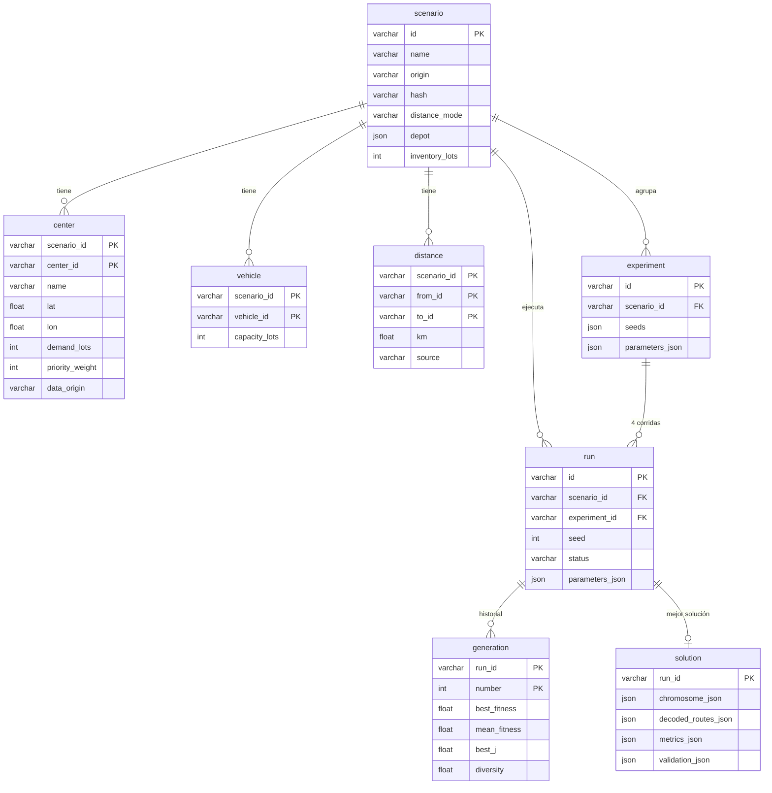

# Base de datos

PostgreSQL 17 en el contenedor `db`, con los datos en el volumen `db_data`. El esquema lo define `backend/app/storage/models.py` (SQLAlchemy 2) y se crea al arrancar la API o el worker. El DDL real, extraído con `pg_dump --schema-only`, está en [esquema.sql](esquema.sql).

En pruebas y en desarrollo sin Docker el mismo modelo funciona sobre SQLite (`DB_URL=sqlite:///./nutriruta.db`).

## Diagrama



## Tablas

### `scenario`

| Columna | Tipo | Descripción |
|---|---|---|
| `id` | varchar(80) PK | Identificador (el indicado por el usuario o un UUID) |
| `name` | varchar(200) | Nombre visible |
| `origin` | varchar(20) | `synthetic`, `official`, `declared`, `mixed` |
| `version` | varchar(20) | Versión del esquema de escenario (`1.0`) |
| `hash` | varchar(64), índice | SHA-256 de centros, flota, inventario, depósito y matriz |
| `created_at` | timestamptz | Fecha de creación |
| `distance_mode` | varchar(20) | `haversine_demo` o `road_matrix` |
| `distance_source` | varchar(120) | `haversine` o el nombre del CSV vial |
| `depot` | json | `{id, name, lat, lon}` |
| `inventory_lots` | integer ≥ 0 | Inventario `B` |
| `data_license` | text | Licencia y fecha de la fuente |
| `notes` | text | Notas libres |
| `priority_criterion` | text | Criterio documentado de prioridades |
| `demand_rule` | json | Regla declarada de demanda, si se usó |
| `fixture_seed` | integer | Semilla del generador demo (independiente de la semilla evolutiva) |

### `center`

Clave primaria `(scenario_id, center_id)`. Solo datos institucionales.

| Columna | Tipo | Descripción |
|---|---|---|
| `name` | varchar(200) | Nombre **institucional** |
| `district` | varchar(120) | Distrito |
| `address` | varchar(250) | Dirección institucional |
| `lat`, `lon` | double precision | Coordenadas (opcionales con matriz vial) |
| `demand_lots` | integer ≥ 0 | Demanda `dᵢ` |
| `priority_weight` | integer 1–3 | Prioridad `pᵢ` |
| `data_origin` | varchar(20) | `synthetic`, `official`, `declared` |
| `demand_origin` | varchar(20) | `synthetic`, `declared`, `inferred` |
| `users_aggregate` | integer | Cifra **agregada** de usuarios, si se cargó |

### `vehicle`

Clave primaria `(scenario_id, vehicle_id)`; `capacity_lots` integer > 0.

### `distance`

Clave primaria `(scenario_id, from_id, to_id)`. Guarda la matriz **completa** (todos los pares ordenados depósito/centro) también en modalidad Haversine: así cada corrida y la línea base leen exactamente los mismos kilómetros. `km` ≥ 0; `source` indica el método, único por escenario.

### `experiment`

Agrupa las cuatro corridas oficiales: `id` (UUID), `scenario_id`, `created_at`, `seeds` (json `[11, 22, 33, 44]`), `parameters_json`, `scenario_hash`, `code_version`.

### `run`

También es la **cola de trabajos** del worker.

| Columna | Tipo | Descripción |
|---|---|---|
| `id` | varchar(36) PK | UUID |
| `scenario_id` | FK | Escenario |
| `experiment_id` | FK, opcional | Experimento al que pertenece |
| `seed` | integer | Semilla evolutiva |
| `parameters_json` | json | Parámetros completos del AG |
| `status` | varchar(12), índice | `queued`, `running`, `completed`, `failed`, `cancelled` |
| `created_at`, `started_at`, `ended_at` | timestamptz | Tiempos |
| `code_version` | varchar(60) | Versión del programa (y commit, si se configuró) |
| `scenario_hash` | varchar(64) | Hash del escenario al encolar |
| `queue_order` | integer | Orden dentro de un experimento |
| `progress_generation` | integer | Última generación publicada |
| `cancel_requested` | boolean | Solicitud de cancelación |
| `stop_reason` | varchar(30) | `max_generations`, `stagnation`, `cancelled` |
| `error_code`, `error_message` | varchar, text | Error legible si falló |

Índice `ix_run_queue (status, created_at, queue_order)` para reclamar la siguiente corrida.

### `generation`

Clave primaria `(run_id, number)`: `best_fitness`, `mean_fitness`, `best_j`, `diversity`.

### `solution`

Una fila por corrida completada (`run_id` PK), solo si superó la validación.

| Columna | Contenido |
|---|---|
| `chromosome_json` | `{pi, q}` con IDs reales |
| `decoded_routes_json` | Rutas por vehículo |
| `metrics_json` | Métricas y datos de la corrida |
| `validation_json` | Resultado de las ocho comprobaciones |
| `assignments_json` | Tabla por centro |
| `repair_json` | Lotes retirados al mejor individuo |
| `baseline_json` | Línea base calculada con la misma instancia |

## Reglas de integridad

- Todas las claves foráneas usan `ON DELETE CASCADE`: borrar un escenario borra sus centros, vehículos, distancias, experimentos, corridas, generaciones y soluciones.
- Restricciones `CHECK`: inventario ≥ 0, demanda ≥ 0, prioridad entre 1 y 3, capacidad > 0, km ≥ 0 y estado de corrida dentro de los cinco valores.
- Un escenario guardado no se actualiza: si se envía el mismo `id` con otro contenido, la API responde `409`.

## Privacidad en el esquema

No existen —ni deben crearse— tablas o columnas de DNI, personas, beneficiarios, sexo o teléfonos. Una prueba automática inspecciona el esquema y el contenido de todas las tablas para comprobarlo (`test_personal_data_never_reaches_database_or_exports`).

## Operación

```bash
docker compose exec db psql -U nutriruta -d nutriruta        # consola SQL
docker compose exec db pg_dump -U nutriruta nutriruta > respaldo.sql
docker compose down -v                                       # BORRA todos los datos
```

No hay migraciones: `create_all` crea las tablas que falten. Si en el futuro cambia el modelo, habrá que añadir una herramienta de migraciones o recrear el volumen.
