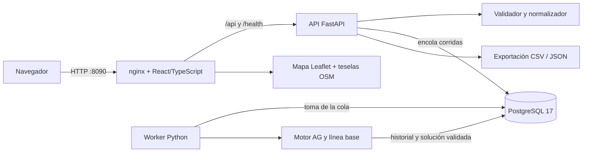

# Especificación del sistema

Resumen de lo que contiene NutriRuta AG versión 1.0.0 y de cómo responde al plan de implementación.

## 1. Propósito y alcance

Aplicación web en español para **cargar o editar un escenario**, ejecutar un **algoritmo genético** que decide cuántos lotes de alimentos asignar a cada centro y cómo agrupar y ordenar las entregas en vehículos, y **visualizar** las soluciones y su evolución.

- **Usuarios:** estudiante o expositor, evaluador docente y operador de datos de prueba.
- **Alcance:** prototipo académico demostrable. No es un sistema oficial de despacho.
- **Fuera de alcance:** registro de beneficiarios, datos personales, valor nutricional, cadena de frío, tiempos de servicio, tráfico, varios viajes por centro, geocodificación de direcciones, autenticación de usuarios.

## 2. Arquitectura

Cuatro contenedores (Docker Compose):

| Servicio | Imagen | Función | Puerto en el equipo |
|---|---|---|---|
| `frontend` | nginx 1.29 + build de Vite | Sirve la interfaz y reenvía `/api` y `/health` | 8090 |
| `api` | Python 3.12 + FastAPI | Valida, persiste, encola y exporta. **Nunca ejecuta el AG.** | 8010 |
| `worker` | misma imagen que `api` | Ejecuta las corridas en cola, una a una | — |
| `db` | PostgreSQL 17 | Persistencia; volumen `db_data` | no expuesto |

La **cola de trabajos** es la propia tabla `run` (estado `queued`), que el worker reclama con `SELECT … FOR UPDATE SKIP LOCKED`. No se necesita Redis: el plan lo deja como opcional. El worker publica el progreso cada 5 generaciones o 0,25 s, atiende cancelaciones al cierre de cada generación y aplica un tiempo máximo por corrida.

## 3. Stack

| Capa | Tecnología |
|---|---|
| Frontend | React 19, TypeScript 6, Vite 8, React Router 7, Recharts 3, Leaflet 1.9 / react-leaflet 5, CSS propio con tokens, IBM Plex Sans + Mono (autoalojadas) |
| Backend | Python 3.12, FastAPI, Pydantic 2, SQLAlchemy 2, NumPy (aleatoriedad PCG64), pandas + openpyxl (lectura de padrón) |
| Persistencia | PostgreSQL 17 en Docker; SQLite en pruebas y desarrollo sin Docker |
| Pruebas | pytest, Hypothesis, httpx; Vitest; Playwright (navegador instalado) |
| Calidad | ruff (lint + formato), ESLint, Prettier, `tsc` |
| Entrega | Docker Compose, Makefile, `scripts/demo.ps1`, GitHub Actions |

El motor del AG está escrito en módulos propios y legibles; NumPy solo aporta el generador aleatorio. Las versiones exactas están fijadas en `backend/requirements.txt` y `frontend/package.json`.

## 4. Módulos del backend

| Módulo | Responsabilidad |
|---|---|
| `app/domain/models.py` | `Problem` (instancia compilada), Haversine, construcción de la matriz |
| `app/domain/validators.py` | Validación y normalización de escenarios, banderas, hash SHA-256 |
| `app/domain/metrics.py` | Métricas, serialización de rutas y asignaciones, validación desde cero |
| `app/ga/chromosome.py` | Cromosoma, fenotipo, individuo, registro de reparación |
| `app/ga/initialization.py` | Población inicial mixta 70/20/10 |
| `app/ga/selection.py` | Torneo |
| `app/ga/crossover.py` | OX y cruce uniforme |
| `app/ga/mutation.py` | Intercambio, inversión y mutación de cantidades |
| `app/ga/repair.py` | Dominio, inventario y capacidad de flota |
| `app/ga/decoder.py` | Empaquetado *first-fit decreasing* y rutas |
| `app/ga/fitness.py` | `U`, `R`, `H`, `J`, fitness |
| `app/ga/evolution.py` | Bucle evolutivo, elitismo, parada, historial |
| `app/ga/params.py` | Parámetros y preset Docente |
| `app/baselines/` | Línea base: prioridad descendente + vecino más cercano |
| `app/data/demo.py` | Generador determinista del escenario sintético |
| `app/data/imports.py` | Importación del padrón con lista permitida y filtro de datos personales |
| `app/data/matrix.py` | Lectura de matriz vial CSV (largo o cuadrado) |
| `app/data/geocoding.py` | Validación de coordenadas declaradas (no geocodifica) |
| `app/storage/` | Modelos, sesiones y repositorio |
| `app/services/run_service.py` | Ejecución de corridas, línea base, resumen de experimentos |
| `app/services/exports.py` | CSV y JSON de evidencia |
| `app/api/` | Rutas, esquemas de entrada, errores estructurados |
| `app/worker.py` | Proceso que consume la cola |

## 5. Interfaz

Siete pantallas (detalle en [guia-de-uso.md](guia-de-uso.md)): Inicio · ODS 2, Escenario (asistente de 4 pasos), Configuración AG, Ejecución, Resultados (pestañas Asignación y Rutas), Cuatro corridas y Glosario académico.

Decisiones de diseño:

- Sistema sobrio de dos familias tipográficas, base 16 px; todo dato (IDs, genes, lotes, km) en monoespaciada.
- Tema claro y oscuro con el mismo juego de tokens; se respeta la preferencia del sistema.
- Estados con icono + texto; vehículos con color + patrón de línea + etiqueta. Nunca rojo/verde como único diferenciador.
- Paleta de series validada para daltonismo y contraste sobre las superficies de la aplicación.
- Indicadores con unidad y definición visibles; se evita «óptimo»: se dice «mejor solución encontrada en esta corrida».
- Cada gráfico tiene su vista de tabla; el mapa tiene alternativa textual completa.
- Escritorio a dos columnas, móvil a una con mapa plegable; botones de al menos 44 × 44 px; foco visible; mensajes de error junto al campo.
- Hoja de estilos de impresión para la captura del informe.

## 6. Historias de usuario

| ID | Historia | Cómo se cumple | Verificación |
|---|---|---|---|
| HU-01 | Cargo el escenario demo | Generador con semilla de fixture fija (2026); origen «synthetic» y nombres «Centro ficticio NN» | `test_demo_scenario_is_valid_synthetic_and_deterministic` |
| HU-02 | Importo un padrón | DNI, nombres de personas, sexo y contacto se descartan antes de construir cualquier resultado y se reportan | `test_personal_data_never_reaches_database_or_exports`, prueba de interfaz |
| HU-03 | Ajusto restricciones | Se rechazan capacidad negativa o 0, coordenadas inválidas y matriz incompleta | `test_invalid_fixtures_are_rejected`, `test_road_matrix_validation_errors` |
| HU-04 | Corro el AG | Fitness por generación y rutas sin duplicados | `test_run_lifecycle_solution_history_and_exports` |
| HU-05 | Comparo alternativas | Misma instancia, unidades y `D_ref` para AG y línea base | `test_four_runs_experiment_and_export` |
| HU-06 | Obtengo evidencia | Exportes con semillas, parámetros, métricas, versión y fecha | mismos tests + `scripts/export_four_runs.py` |
| HU-07 | Interpreto el resultado en móvil | Indicadores y tablas legibles; el mapa empieza plegado | capturas a 400 px, sin desborde horizontal |

## 7. Criterios de aceptación globales

| Criterio | Estado |
|---|---|
| Corre localmente con instrucciones reproducibles y sin servicios de pago | Cumplido (`docker compose up -d --build`) |
| El modo demo usa únicamente centros sintéticos identificados | Cumplido |
| El importador usa solo campos institucionales y excluye DNI, nombres de personas y sexo | Cumplido |
| No se ejecuta una corrida sin inventario, demandas, flota, depósito y matriz validados | Cumplido (el escenario no se puede guardar) |
| Toda solución mostrada cumple inventario, capacidades y visitas | Cumplido (validación desde cero antes de publicar) |
| El AG incluye codificación, decodificación, fitness, selección, OX, mutación, población y elitismo explicables | Cumplido |
| Se muestran asignaciones, rutas, fitness por generación y factibilidad | Cumplido |
| Existe una línea base comparable en el mismo escenario | Cumplido |
| Se ejecutan y exportan exactamente cuatro corridas (11, 22, 33, 44) | Cumplido |
| Las cifras provienen del programa | Cumplido (ver [evidencia-corridas.md](evidencia-corridas.md)) |
| La documentación vincula el problema con ODS 2.1 y declara sus límites | Cumplido |

## 8. Límites del MVP y configuración

| Límite | Valor por defecto | Variable |
|---|---|---|
| Centros por escenario | 5 a 50 | `MIN_CENTERS`, `MAX_CENTERS` |
| Vehículos | hasta 20 | `MAX_VEHICLES` |
| Generaciones | hasta 1000 | `MAX_GENERATIONS` |
| Población | hasta 500 | `MAX_POPULATION` |
| Archivo subido | 5 MB, 5000 filas | `MAX_UPLOAD_MB` |
| Cuerpo JSON | 2 MB | `MAX_JSON_MB` |
| Duración de una corrida | 120 s | `MAX_RUN_SECONDS` |

## 9. Lo que queda fuera o pendiente

- **Motor local de rutas** (opción B de distancias): no instalado; la interfaz lo muestra deshabilitado.
- **Exportación PDF**: se resuelve con la impresión del navegador («Guardar como PDF»), no con un generador propio.
- **Autenticación y límites de tasa**: necesarios si la demo se publica en internet; el despliegue por defecto es local.
- **Migraciones de esquema**: las tablas se crean al arrancar; no hay historial de migraciones.
- **Prioridad P2 del plan** (comparación interactiva de operadores, análisis de sensibilidad de pesos): solo parcialmente, mediante el modo «Experimental».
- **Control de versiones**: la carpeta no es todavía un repositorio git; `GIT_COMMIT` permite registrar el commit en cada corrida cuando lo sea.
- **Secciones 7 y 8 del informe Word**: deben completarlas los integrantes con lo documentado aquí y en `evidencia-corridas.md`.
