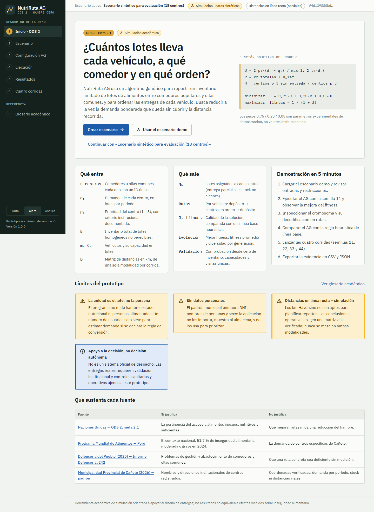
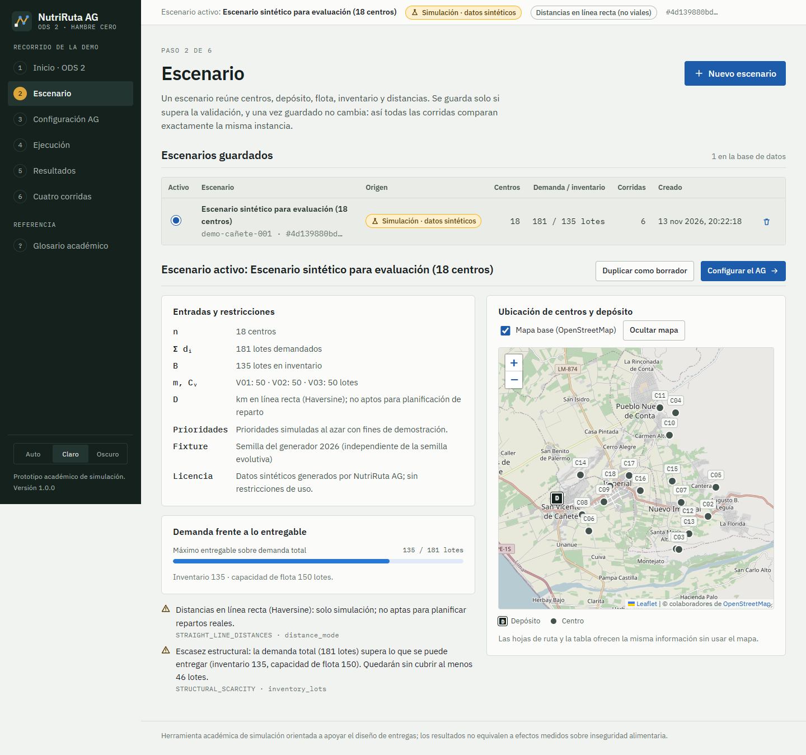
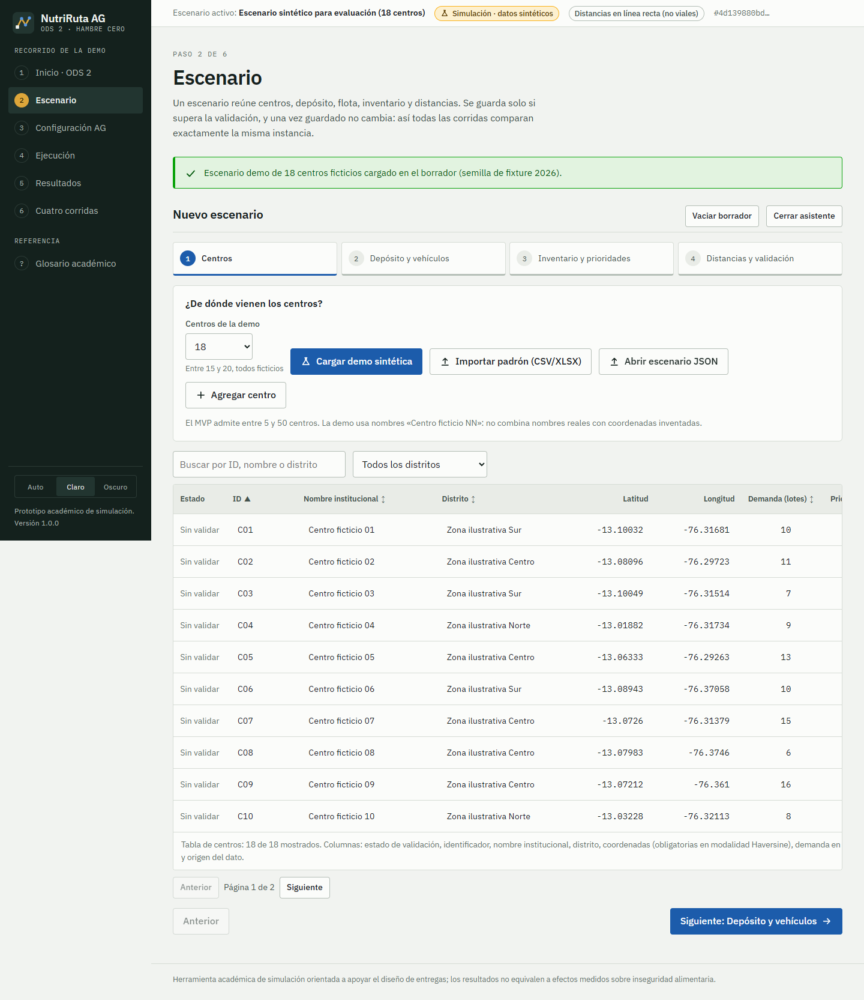
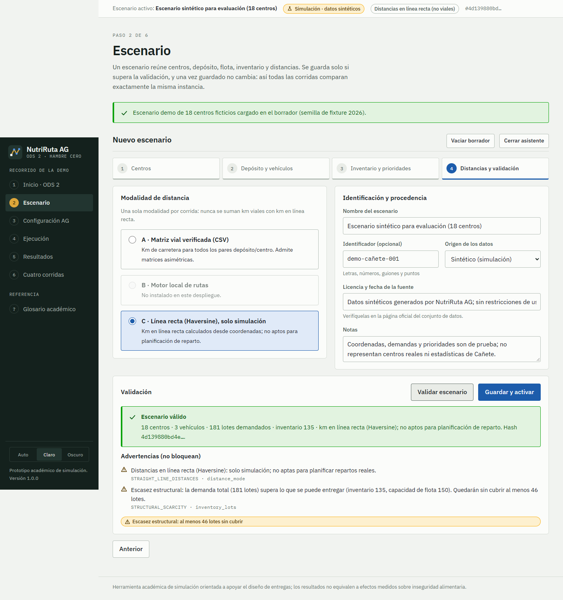
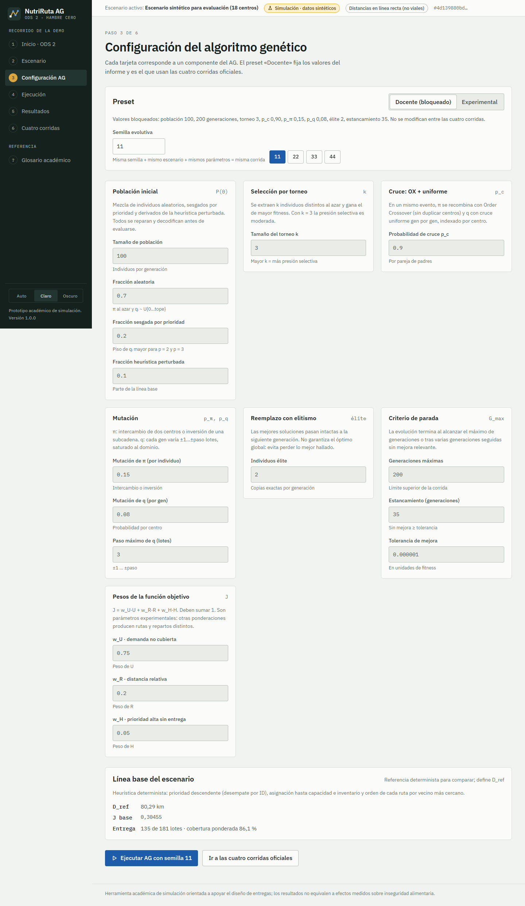
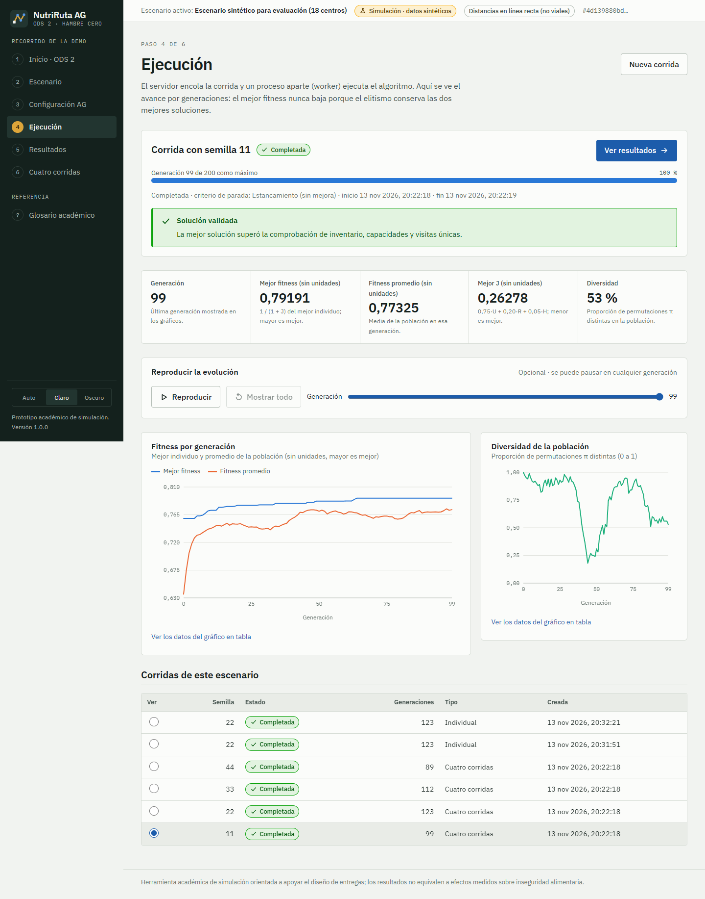
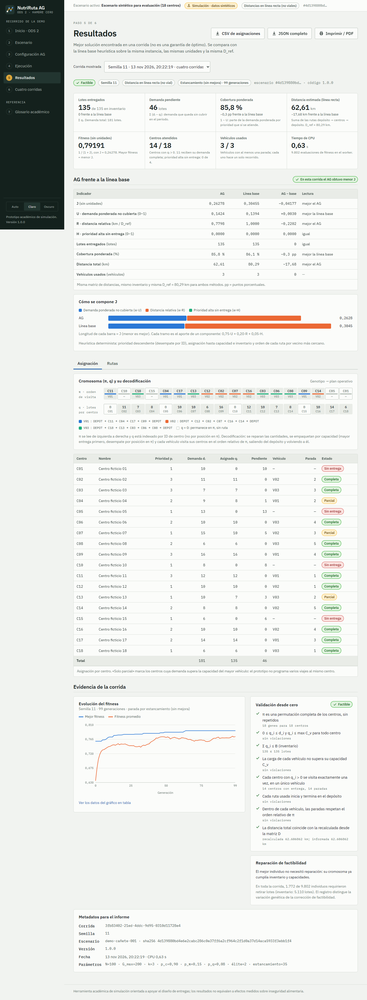
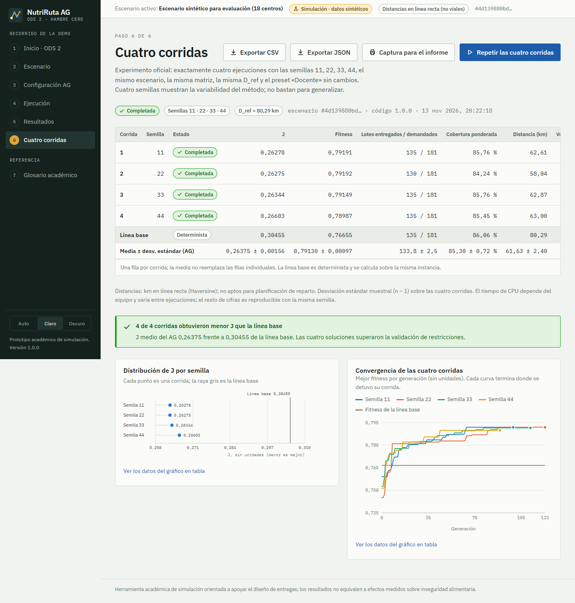
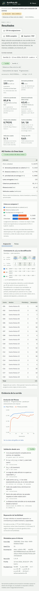

# Guía de uso de NutriRuta AG

Cómo levantar la aplicación y recorrerla pantalla por pantalla. Para saber *qué* contiene el sistema, vea [especificacion.md](especificacion.md); para el modelo, [modelo-matematico.md](modelo-matematico.md).

## 1. Ponerla en marcha

```bash
docker compose up -d --build
```

Abra **http://localhost:8090**. La primera construcción tarda unos minutos; las siguientes, segundos.

| Quiero… | Comando |
|---|---|
| Ver que todo está arriba | `docker compose ps` (los cuatro servicios en `Up`, `api`/`db`/`frontend` en `healthy`) |
| Detener sin perder datos | `docker compose down` |
| Ver registros | `docker compose logs -f api worker` |
| Empezar de cero (borra escenarios y corridas) | `docker compose down -v` y luego `docker compose up -d --build` |
| Demo completa de un tirón | `make demo` o `scripts\demo.ps1` |

Si el puerto 8090 está ocupado, cree un archivo `.env` (copie `.env.example`) y cambie `FRONTEND_PORT`.

## 2. Mapa de la aplicación

La barra lateral sigue el orden de la demostración. La franja superior muestra siempre el **escenario activo**, su procedencia («Simulación · datos sintéticos» o «Datos … · por verificar»), la modalidad de distancia y el hash del escenario.

| Paso | Pantalla | Para qué sirve |
|---|---|---|
| 1 | Inicio · ODS 2 | Problema, entradas y salidas, fórmula, límites y fuentes |
| 2 | Escenario | Cargar la demo, importar un padrón o construir un escenario; validarlo y guardarlo |
| 3 | Configuración AG | Parámetros del algoritmo, preset «Docente» y semilla |
| 4 | Ejecución | Avance por generaciones, fitness, diversidad, cancelar |
| 5 | Resultados | Asignación, rutas, mapa, comparación con la línea base, evidencia |
| 6 | Cuatro corridas | Experimento 11/22/33/44, tabla, gráficos y exportación |
| ? | Glosario académico | Conceptos de AG enlazados a la aplicación y al código |

En la barra lateral también se elige el tema (Auto / Claro / Oscuro).

## 3. Camino corto: la demo

1. En **Inicio**, pulse **«Usar el escenario demo»**. Se genera el escenario sintético (18 centros, semilla de fixture 2026), se guarda como `demo-cañete-001` y se abre la configuración.
2. En **Configuración AG**, deje el preset **Docente** y la semilla **11**; pulse **«Ejecutar AG con semilla 11»**.
3. En **Ejecución** verá la corrida completarse (menos de un segundo de CPU en el escenario demo). Pulse **«Ver resultados»**.
4. En **Cuatro corridas**, pulse **«Lanzar las cuatro corridas»** y luego **«Exportar CSV»**.



## 4. Escenario

### 4.1 Escenarios guardados

La tabla lista los escenarios de la base de datos. El botón de opción de la primera columna **activa** un escenario: todo lo demás (configuración, corridas, resultados) trabaja sobre el activo. Debajo se muestran sus entradas y restricciones, la relación demanda/entregable y un mapa de ubicación.

Un escenario guardado **no se modifica** (así todas las corridas comparan la misma instancia). Para cambiar algo use **«Duplicar como borrador»**, edite y guarde con otro nombre. El icono de papelera elimina el escenario junto con sus corridas, previa confirmación.



### 4.2 Asistente de 4 pasos («Nuevo escenario»)

**Paso 1 · Centros.** Cuatro formas de cargar centros:

- **Cargar demo sintética** (15 a 20 centros ficticios).
- **Importar padrón (CSV/XLSX)**: vea 4.3.
- **Abrir escenario JSON**: un archivo con el contrato de escenario (por ejemplo `fixtures/synthetic_small/scenario.json` o un export de la aplicación). Los campos fuera del contrato se descartan.
- **Agregar centro** manualmente.

La tabla es editable y permite buscar, filtrar por distrito, ordenar por columna y paginar. Tras validar, cada fila muestra su estado («Válido» o el número de errores) y se puede filtrar «Solo filas con errores». «Conservar solo estos N» recorta la lista a lo filtrado (útil si el padrón trae más de 50 centros).



**Paso 2 · Depósito y vehículos.** ID y coordenadas del depósito (obligatorias solo en modalidad Haversine) y la lista de vehículos con su capacidad en lotes.

**Paso 3 · Inventario y prioridades.** Inventario `B`, criterio de prioridad (texto auditable), botón «prioridad uniforme p = 1» y la **regla declarada de demanda**: `demanda = ⌈usuarios × raciones por usuario / raciones por lote⌉`, que solo se aplica a centros con cifra agregada de usuarios y deja la demanda rotulada «inferida».

**Paso 4 · Distancias y validación.**

| Modalidad | Cuándo usarla |
|---|---|
| A · Matriz vial verificada (CSV) | Para conclusiones operativas. Formato largo `from_id,to_id,km` o matriz cuadrada. Debe contener todos los pares depósito/centro. |
| B · Motor local de rutas | No instalado en este despliegue (opción deshabilitada). |
| C · Línea recta (Haversine) | Solo simulación. Se calcula desde coordenadas. |

Complete nombre, origen de datos y licencia; pulse **«Validar escenario»**. Si hay errores, se listan con su código y campo, y «Guardar y activar» permanece deshabilitado. Las advertencias (por ejemplo, escasez estructural o distancias en línea recta) no bloquean.



### 4.3 Importar un padrón

1. Descargue el recurso oficial desde su página, revise **fecha y licencia**, y guarde una copia local.
2. En el paso 1 pulse **«Importar padrón (CSV/XLSX)»** y elija el archivo (máximo 5 MB).
3. La aplicación muestra cada columna y su tratamiento:
   - **Dato personal · se descarta**: DNI, nombres y apellidos, sexo, teléfonos, etc. No se pueden asignar a ningún campo.
   - **Se importa**: columnas asignadas a un campo institucional (código, nombre institucional, distrito, dirección, estado, usuarios agregados, latitud, longitud, demanda, prioridad).
   - **Se descarta**: el resto.
4. Opcional: active la regla declarada de demanda.
5. **«Depurar e importar»** muestra el informe: filas aceptadas, duplicadas por código, inactivas ignoradas, rechazadas (con motivo) y campos personales removidos.
6. **«Usar estos N centros»** los lleva a la tabla. Después hay que completar lo que el padrón no trae: demanda, coordenadas o matriz vial, flota, inventario y depósito. Mientras falte algo, el escenario no se puede guardar ni ejecutar.

Para probar el flujo sin datos reales use `fixtures/invalid/padron_con_pii_ficticio.csv` (inventado).

## 5. Configuración AG

- **Preset Docente (bloqueado)**: población 100, 200 generaciones, torneo 3, `p_c` 0,90, `p_π` 0,15, `p_q` 0,08, élite 2, estancamiento 35, pesos 0,75/0,20/0,05. Es el que usan las cuatro corridas.
- **Experimental**: desbloquea todos los campos. La página avisa si las fracciones de población inicial o los pesos no suman 1, o si se superan los límites del servidor.
- **Semilla evolutiva**: cualquier entero ≥ 0; los botones 11/22/33/44 son las semillas oficiales.

La tarjeta «Línea base del escenario» muestra `D_ref` y el `J` de la heurística de referencia.



## 6. Ejecución

Muestra estado (en cola, en ejecución, completada, fallida, cancelada), barra de avance, cinco indicadores y dos gráficos: fitness (mejor y promedio) y diversidad de la población. Cada gráfico tiene «Ver los datos del gráfico en tabla».

- **Cancelar corrida**: una corrida en cola se cancela de inmediato; una en ejecución, al cerrar la generación en curso. No se publica solución.
- **Reproducir la evolución**: al terminar, permite ver crecer las curvas generación a generación, pausar y mover el deslizador.
- **Corridas de este escenario**: lista para volver a cualquier corrida anterior.

Si una corrida falla, se muestra el código y un mensaje legible (por ejemplo `TIME_LIMIT`).



## 7. Resultados

- **Indicadores** con unidad y definición: lotes entregados, demanda pendiente, cobertura ponderada, distancia (rotulada «línea recta» o «vía real»), fitness, centros atendidos, vehículos usados y tiempo de CPU.
- **AG frente a la línea base**: tabla con diferencia y lectura por indicador, y barras que descomponen `J` en sus tres aportes. Si el AG no supera a la línea base, se indica tal cual.
- **Pestaña Asignación**: el cromosoma `(π, q)` como dos tiras de genes y la tabla por centro (demanda, asignado, pendiente, vehículo, parada, estado).
- **Pestaña Rutas**: una hoja de ruta por vehículo (paradas en orden, lotes, carga/capacidad, km) y el mapa. Las líneas son discontinuas con un patrón distinto por vehículo: son conexiones esquemáticas, no el trazado de calles. El mapa se puede ocultar; en pantallas angostas empieza plegado.
- **Evidencia de la corrida**: curva de fitness, las ocho comprobaciones de la validación desde cero, el registro de reparación y los metadatos para el informe (ID, semilla, hash, versión, fecha, parámetros).
- **Exportar**: «CSV de asignaciones», «JSON completo» e «Imprimir / PDF» (usa la hoja de estilos de impresión; elija «Guardar como PDF» en el diálogo).



## 8. Cuatro corridas

**«Lanzar las cuatro corridas»** encola exactamente las semillas 11, 22, 33 y 44 con el preset Docente. La tabla se actualiza sola y, al terminar, muestra una fila por corrida, la fila de la línea base y la media ± desviación estándar muestral. Debajo: `J` por semilla frente a la línea base y las cuatro curvas de convergencia.

- **Exportar CSV / JSON**: disponibles solo cuando las cuatro corridas terminaron (no se exportan tablas parciales).
- **Captura para el informe**: abre el diálogo de impresión con una versión limpia de la página.
- **Ver solución**: abre la corrida en Resultados.

Desde la terminal, `python scripts/export_four_runs.py --api http://localhost:8090 --out docs/evidencia` hace lo mismo y guarda los archivos.



## 9. Accesibilidad y móvil

- Navegación completa por teclado; el primer tabulador ofrece «Saltar al contenido». El foco siempre es visible.
- Los estados nunca dependen solo del color: llevan icono y texto; los vehículos se distinguen además por patrón de línea y etiqueta.
- Todo lo que muestra el mapa está también en tablas y hojas de ruta.
- En móvil la interfaz pasa a una columna, con menú desplegable y tablas con desplazamiento propio.
- Se respeta la preferencia de movimiento reducido del sistema.



## 10. Preguntas frecuentes

**¿Por qué quedan lotes sin entregar si hay inventario?** Porque el empaquetado por capacidad o la reparación no siempre logran ubicar todo, y porque entregar menos puede reducir la distancia lo suficiente para bajar `J`. La semilla 22 del demo entrega 130 de 135 lotes por ese compromiso.

**¿Por qué un centro recibe solo una parte?** Hay escasez estructural (demanda 181 frente a 135 entregables en la demo) o su demanda supera al vehículo más grande.

**¿La misma semilla da siempre lo mismo?** Sí, con el mismo escenario, parámetros y versión. Solo cambia el tiempo de CPU.

**¿Puedo usar distancias reales?** Sí: modalidad A con una matriz CSV completa. La aplicación nunca mezcla km viales con km en línea recta.

**El mapa no carga.** Las teselas vienen de OpenStreetMap y necesitan internet. Desactive «Mapa base» para ver solo puntos y rutas; tablas y hojas de ruta funcionan siempre.

**«No hay conexión con el servidor».** Ejecute `docker compose ps` y revise `docker compose logs api`.
